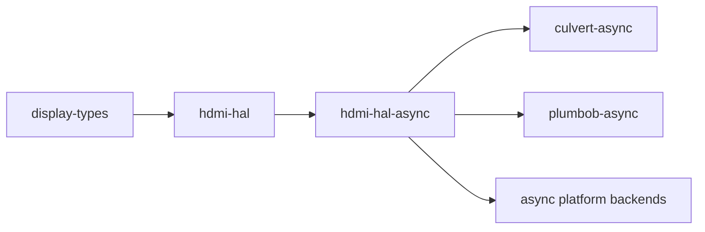

# hdmi-hal-async

[](https://github.com/DracoWhitefire/hdmi-hal-async/actions/workflows/ci.yml)
[](https://crates.io/crates/hdmi-hal-async)
[](https://docs.rs/hdmi-hal-async)
[](LICENSE)
[](https://blog.rust-lang.org/2025/02/20/Rust-1.85.0.html)
[](https://slsa.dev)

Async hardware abstraction traits for the HDMI stack.

`hdmi-hal-async` is the async companion to [`hdmi-hal`](https://crates.io/crates/hdmi-hal),
following the same split as `embedded-hal` / `embedded-hal-async`. It mirrors each trait
in `hdmi-hal` with `async fn` methods and otherwise identical signatures — `ScdcTransport`
for raw SCDC register access and `HdmiPhy` for PHY lane configuration. Data types such as
`EqParams` are defined in `hdmi-hal` and re-exported here rather than duplicated.

Sync consumers continue to use `hdmi-hal` directly. Async platform backends (Embassy
drivers, async kernel drivers) implement the traits here. The two crates impose no
executor dependency on each other or their consumers.

## Usage

```toml
[dependencies]
hdmi-hal-async = "0.1"
```

Implement a trait against your async hardware backend:

```rust
use hdmi_hal_async::scdc::ScdcTransport;

struct MyAsyncI2cBackend { /* ... */ }

impl ScdcTransport for MyAsyncI2cBackend {
    type Error = MyError;

    async fn read(&mut self, reg: u8) -> Result<u8, MyError> { /* ... */ }
    async fn write(&mut self, reg: u8, value: u8) -> Result<(), MyError> { /* ... */ }
}
```

Accept a trait bound in consumer code:

```rust
use hdmi_hal_async::scdc::ScdcTransport;

async fn configure_frl<T: ScdcTransport>(transport: &mut T) -> Result<(), T::Error> {
    transport.write(0x31, 0x01).await?; // initiate FRL
    Ok(())
}
```

## Stack position

`hdmi-hal-async` mirrors `hdmi-hal`'s position in the stack, serving async platform
backends and async protocol logic. It depends on `hdmi-hal` for shared data types.



## Out of scope

- **Protocol logic** — typed SCDC register wrappers and async link training belong in
  the crates that consume `ScdcTransport`.
- **Implementations** — async platform backends live in the crates that use these traits.
- **Sync/async adapters** — wrappers that bridge sync implementations to async trait
  bounds belong in a compatibility shim crate, not here.
- **Executor dependency** — the traits impose no constraint on which async runtime is used.

## Documentation

- [`doc/architecture.md`](doc/architecture.md) — trait surfaces, design principles, and async/sync split
- [`doc/roadmap.md`](doc/roadmap.md) — planned features and future work

## Verifying releases

Each release is built on GitHub Actions and attested with
[SLSA Build Level 2](https://slsa.dev) provenance. To verify a release
`.crate` against its signed provenance, install the
[GitHub CLI](https://cli.github.com/) and run:

```sh
gh attestation verify hdmi-hal-async-X.Y.Z.crate --repo DracoWhitefire/hdmi-hal-async
```

The attested `.crate` is attached to each
[GitHub release](https://github.com/DracoWhitefire/hdmi-hal-async/releases).

## License

Licensed under the [Mozilla Public License 2.0](LICENSE).
